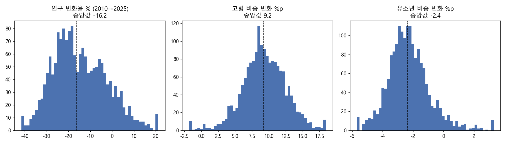
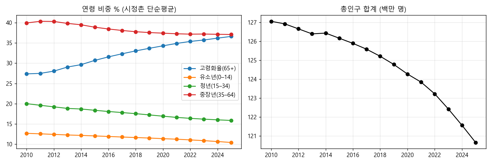
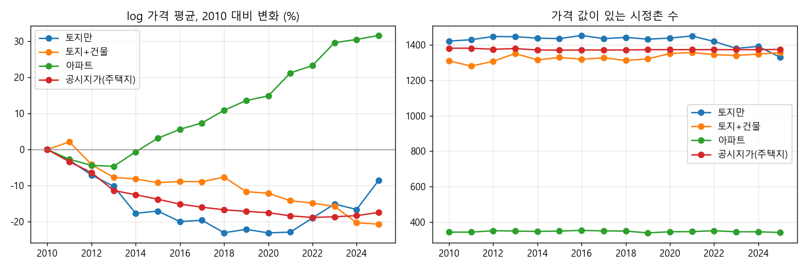
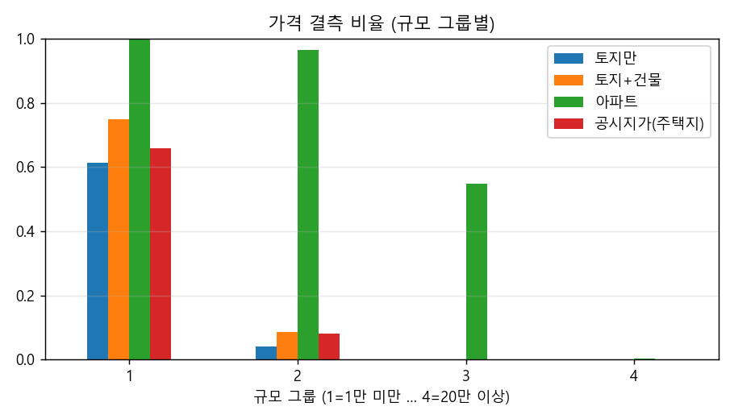

# 1단계. 데이터 눈으로 보기

입력 `panel.csv` 27,856행(1,741 시정촌 × 2010~2025). 만든 스크립트 `01_describe.py`.

## 1. 변수별 평균·최소·최대·결측 비율

avg3_* 열은 끝점 연도(2010/2015/2020/2025)에만 값이 있어 결측 비율이 높게 나옴.

|                     |      평균 |   표준편차 |    최소 |    중앙값 |        최대 |   결측비율 |
|:--------------------|----------:|-----------:|--------:|----------:|------------:|-----------:|
| n_land              |    59.908 |    118.257 |   0.000 |    24.000 |    2205.000 |      0.000 |
| log_p_land          |     9.884 |      1.243 |   2.228 |     9.803 |      15.400 |      0.182 |
| n_landbldg          |    66.667 |    182.324 |   0.000 |    18.000 |    4358.000 |      0.000 |
| log_p_landbldg      |    10.611 |      1.191 |   5.573 |    10.519 |      15.538 |      0.237 |
| n_condo             |    29.665 |    172.578 |   0.000 |     0.000 |    4900.000 |      0.000 |
| log_p_condo         |    12.352 |      0.562 |   3.373 |    12.296 |      14.488 |      0.800 |
| n_chika             |    10.232 |     25.800 |   0.000 |     3.000 |     559.000 |      0.000 |
| log_p_chika         |    10.398 |      0.920 |   7.438 |    10.299 |      15.118 |      0.211 |
| pop_total           | 71692.628 | 182568.827 | 156.000 | 24354.500 | 3657691.000 |      0.000 |
| log_pop             |    10.063 |      1.498 |   5.050 |    10.100 |      15.112 |      0.000 |
| child_rate          |    11.647 |      2.541 |   1.966 |    11.663 |      24.934 |      0.000 |
| youth_rate          |    17.702 |      3.405 |   5.356 |    17.839 |      32.333 |      0.000 |
| middle_rate         |    38.392 |      2.901 |  23.298 |    38.717 |      54.706 |      0.000 |
| elderly_rate        |    32.260 |      7.847 |  10.909 |    31.587 |      68.491 |      0.000 |
| aging_rate          |    32.260 |      7.847 |  10.909 |    31.587 |      68.491 |      0.000 |
| share_15_19         |     4.536 |      0.822 |   0.588 |     4.616 |      18.898 |      0.000 |
| share_20_34         |    13.165 |      2.965 |   4.440 |    13.144 |      27.044 |      0.000 |
| share_65_74         |    14.861 |      2.868 |   4.242 |    14.691 |      25.801 |      0.000 |
| share_75p           |    17.399 |      5.581 |   3.571 |    16.887 |      45.260 |      0.000 |
| pop2010             | 72979.816 | 180759.095 | 165.000 | 25932.000 | 3620562.000 |      0.000 |
| size_group          |     2.126 |      0.892 |   1.000 |     2.000 |       4.000 |      0.000 |
| kaso_dummy          |     0.418 |      0.493 |   0.000 |     0.000 |       1.000 |      0.000 |
| avg3_log_p_land     |     9.793 |      1.245 |   2.228 |     9.697 |      15.085 |      0.779 |
| avg3_log_p_landbldg |    10.505 |      1.194 |   6.812 |    10.397 |      15.431 |      0.792 |
| avg3_log_p_condo    |    12.338 |      0.541 |  10.666 |    12.278 |      14.365 |      0.947 |
| avg3_log_p_chika    |    10.403 |      0.921 |   7.472 |    10.309 |      15.030 |      0.803 |

## 2. 시정촌 안에서 2010→2025 변한 양

행 = 시정촌 1,741개. 규모 그룹 1 = 1만 미만, 2 = 1~5만, 3 = 5~20만, 4 = 20만 이상.

|                   |    최소 |     p10 |     p25 |   중앙값 |    p75 |    p90 |   최대 |    평균 |   규모1 중앙값 |   규모2 중앙값 |   규모3 중앙값 |   규모4 중앙값 |   비과소 중앙값 |   과소 중앙값 |
|:------------------|--------:|--------:|--------:|---------:|-------:|-------:|-------:|--------:|---------------:|---------------:|---------------:|---------------:|----------------:|--------------:|
| 인구변화율_%      | -46.149 | -29.346 | -23.738 |  -16.230 | -5.886 |  2.138 | 52.034 | -14.599 |        -24.488 |        -18.336 |         -7.860 |         -2.564 |          -7.854 |       -24.678 |
| 고령비중변화_%p   | -11.910 |   5.409 |   7.268 |    9.188 | 11.359 | 13.320 | 24.285 |   9.266 |          9.526 |         10.079 |          8.544 |          6.943 |           8.486 |        10.418 |
| 유소년비중변화_%p |  -8.182 |  -3.860 |  -3.155 |   -2.378 | -1.546 | -0.513 |  9.301 |  -2.261 |         -2.102 |         -2.526 |         -2.469 |         -2.185 |          -2.411 |        -2.355 |
| 청년비중변화_%p   | -10.722 |  -6.020 |  -5.101 |   -4.212 | -3.323 | -2.395 |  9.075 |  -4.148 |         -3.983 |         -4.588 |         -4.050 |         -3.521 |          -4.152 |        -4.312 |
| 중장년비중변화_%p | -12.815 |  -5.335 |  -4.087 |   -2.803 | -1.533 | -0.557 |  7.483 |  -2.856 |         -3.681 |         -3.142 |         -2.068 |         -1.314 |          -2.029 |        -3.812 |

## 3. 전국 연도별 추이

비중은 시정촌 단순평균(인구 가중 아님). 가격은 값 있는 시정촌의 log 가격 평균.

|   year |   고령화율_평균 |   유소년비중_평균 |   청년비중_평균 |   중장년비중_평균 |   총인구_합계 |   토지만_log가격_평균 |   토지만_값있는시정촌수 |   토지+건물_log가격_평균 |   토지+건물_값있는시정촌수 |   아파트_log가격_평균 |   아파트_값있는시정촌수 |   공시지가(주택지)_log가격_평균 |   공시지가(주택지)_값있는시정촌수 |
|-------:|----------------:|------------------:|----------------:|------------------:|--------------:|----------------------:|------------------------:|-------------------------:|---------------------------:|----------------------:|------------------------:|--------------------------------:|----------------------------------:|
|   2010 |          27.369 |            12.666 |          20.002 |            39.963 | 127057860.000 |                10.038 |                1421.000 |                   10.713 |                   1310.000 |                12.240 |                 344.000 |                          10.536 |                          1381.000 |
|   2011 |          27.488 |            12.544 |          19.599 |            40.369 | 126923410.000 |                10.008 |                1429.000 |                   10.734 |                   1280.000 |                12.213 |                 344.000 |                          10.502 |                          1381.000 |
|   2012 |          28.051 |            12.406 |          19.215 |            40.328 | 126659683.000 |                 9.967 |                1447.000 |                   10.671 |                   1307.000 |                12.196 |                 352.000 |                          10.472 |                          1375.000 |
|   2013 |          29.063 |            12.261 |          18.830 |            39.846 | 126393679.000 |                 9.936 |                1446.000 |                   10.636 |                   1351.000 |                12.193 |                 350.000 |                          10.422 |                          1379.000 |
|   2014 |          29.656 |            12.154 |          18.684 |            39.507 | 126434634.000 |                 9.861 |                1438.000 |                   10.631 |                   1315.000 |                12.234 |                 348.000 |                          10.411 |                          1371.000 |
|   2015 |          30.702 |            12.027 |          18.362 |            38.909 | 126163576.000 |                 9.867 |                1435.000 |                   10.621 |                   1329.000 |                12.271 |                 350.000 |                          10.398 |                          1370.000 |
|   2016 |          31.572 |            11.893 |          18.065 |            38.469 | 125891742.000 |                 9.838 |                1453.000 |                   10.624 |                   1319.000 |                12.296 |                 354.000 |                          10.385 |                          1371.000 |
|   2017 |          32.338 |            11.756 |          17.804 |            38.103 | 125583658.000 |                 9.841 |                1435.000 |                   10.624 |                   1327.000 |                12.314 |                 351.000 |                          10.376 |                          1371.000 |
|   2018 |          33.050 |            11.625 |          17.530 |            37.795 | 125209603.000 |                 9.807 |                1442.000 |                   10.636 |                   1312.000 |                12.349 |                 350.000 |                          10.369 |                          1371.000 |
|   2019 |          33.691 |            11.502 |          17.223 |            37.584 | 124776364.000 |                 9.816 |                1432.000 |                   10.596 |                   1321.000 |                12.376 |                 340.000 |                          10.364 |                          1373.000 |
|   2020 |          34.310 |            11.350 |          16.902 |            37.437 | 124271318.000 |                 9.807 |                1438.000 |                   10.592 |                   1351.000 |                12.389 |                 346.000 |                          10.361 |                          1373.000 |
|   2021 |          34.895 |            11.214 |          16.607 |            37.284 | 123842701.000 |                 9.809 |                1450.000 |                   10.571 |                   1357.000 |                12.452 |                 347.000 |                          10.352 |                          1373.000 |
|   2022 |          35.391 |            11.043 |          16.374 |            37.193 | 123223561.000 |                 9.848 |                1419.000 |                   10.564 |                   1345.000 |                12.473 |                 352.000 |                          10.348 |                          1373.000 |
|   2023 |          35.745 |            10.859 |          16.176 |            37.220 | 122423038.000 |                 9.887 |                1380.000 |                   10.555 |                   1340.000 |                12.536 |                 346.000 |                          10.350 |                          1373.000 |
|   2024 |          36.203 |            10.639 |          16.001 |            37.157 | 121561801.000 |                 9.871 |                1391.000 |                   10.510 |                   1348.000 |                12.545 |                 346.000 |                          10.353 |                          1373.000 |
|   2025 |          36.635 |            10.404 |          15.854 |            37.106 | 120653227.000 |                 9.952 |                1330.000 |                   10.506 |                   1356.000 |                12.556 |                 342.000 |                          10.362 |                          1374.000 |

## 4. 가격이 결측인 시정촌·연도가 어떤 곳인지

결측 = 거래 5건 미만(공시지가는 지점 0). 16년 내내 한 번도 값이 없는 시정촌 수: 토지만 84곳, 토지+건물 156곳, 아파트 1351곳, 공시지가(주택지) 356곳.

|                                 |     행 수 |   비율 |   고령화율 평균 |   유소년비중 평균 |   인구 중앙값 |   과소 비율 |   규모1 비율 |   규모2 비율 |   규모3 비율 |   규모4 비율 |
|:--------------------------------|----------:|-------:|----------------:|------------------:|--------------:|------------:|-------------:|-------------:|-------------:|-------------:|
| ('토지만', '값 있음')           | 22786.000 |  0.818 |          30.676 |            12.041 |     34106.500 |       0.313 |        0.127 |        0.479 |        0.304 |        0.090 |
| ('토지만', '결측')              |  5070.000 |  0.182 |          39.381 |             9.876 |      3514.000 |       0.886 |        0.909 |        0.091 |        0.000 |        0.000 |
| ('토지+건물', '값 있음')        | 21268.000 |  0.763 |          30.505 |            12.053 |     37586.000 |       0.290 |        0.088 |        0.490 |        0.326 |        0.096 |
| ('토지+건물', '결측')           |  6588.000 |  0.237 |          37.924 |            10.335 |      4295.500 |       0.829 |        0.854 |        0.146 |        0.000 |        0.000 |
| ('아파트', '값 있음')           |  5562.000 |  0.200 |          25.676 |            12.889 |    150744.500 |       0.009 |        0.000 |        0.069 |        0.564 |        0.367 |
| ('아파트', '결측')              | 22294.000 |  0.800 |          33.902 |            11.337 |     15975.000 |       0.520 |        0.337 |        0.493 |        0.170 |        0.000 |
| ('공시지가(주택지)', '값 있음') | 21982.000 |  0.789 |          30.619 |            12.007 |     35637.000 |       0.305 |        0.117 |        0.475 |        0.315 |        0.093 |
| ('공시지가(주택지)', '결측')    |  5874.000 |  0.211 |          38.401 |            10.299 |      4006.500 |       0.837 |        0.841 |        0.159 |        0.000 |        0.000 |

## 5. 인구와 고령 비중의 within 상관 / VIF

within = 각 시정촌의 16년 평균을 뺀 값끼리의 상관. 고정효과 모형이 실제로 쓰는 변동.

|              |   log_pop |   child_rate |   youth_rate |   middle_rate |   elderly_rate |
|:-------------|----------:|-------------:|-------------:|--------------:|---------------:|
| log_pop      |     1.000 |        0.672 |        0.706 |         0.773 |         -0.811 |
| child_rate   |     0.672 |        1.000 |        0.664 |         0.617 |         -0.811 |
| youth_rate   |     0.706 |        0.664 |        1.000 |         0.742 |         -0.923 |
| middle_rate  |     0.773 |        0.617 |        0.742 |         1.000 |         -0.910 |
| elderly_rate |    -0.811 |       -0.811 |       -0.923 |        -0.910 |          1.000 |

VIF (within 변환 후). 빈칸은 그 모형에 안 들어가는 변수.

|              |   표 A (고령 비중 + log 인구) |   표 H1-1 (유소년·청년·고령 + log 인구) |
|:-------------|------------------------------:|----------------------------------------:|
| child_rate   |                       nan     |                                   3.415 |
| elderly_rate |                         2.919 |                                  16.803 |
| log_pop      |                         2.919 |                                   3.033 |
| youth_rate   |                       nan     |                                   8.212 |
